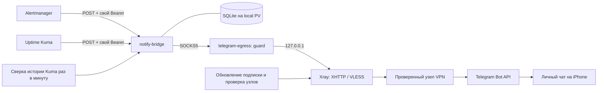

# Notify Bridge («NATS Fiber Bridge»)

Компонент доставки аварийных уведомлений для `updspace-home`. Одна Go-служба
с SQLite принимает события Alertmanager и Uptime Kuma. Отдельный pod выводит
только Telegram Bot API через VPN-подписку владельца. Развёртывание — k3s,
namespace `notifications`; внешнего входящего HTTP-маршрута нет.

Название из обсуждения сохранено как рабочее. Реализация использует `net/http`
и SQLite: отдельные NATS, Redis, Fiber и PostgreSQL для этого объёма не нужны.



## Доступ в Telegram

Прямое соединение VM с `api.telegram.org:443` не устанавливалось до TLS.
DNS совпал с независимым DNS-over-HTTPS. Пробы ByeDPI с обычным SOCKS,
разбиением и перестановкой TLS не помогли. Предоставленная владельцем
подписка содержит VLESS/XHTTP; через неё проверка Telegram прошла.

`telegram-egress` содержит два непривилегированных процесса:

- `guard` принимает SOCKS CONNECT исключительно к имени `api.telegram.org:443`.
  IP-адреса, другие домены, UDP и BIND отвергаются.
- Xray слушает только `127.0.0.1:1081`, передаёт разрешённый запрос VPN-узлу,
  а все остальные назначения блокирует. Полный HTTPS до Telegram проверяет
  клиент bridge; VPN не завершает это TLS-соединение.

У pod нет hostNetwork, TUN, NET_ADMIN, доступа к firewall и service-account
токена. NetworkPolicy разрешает вход только bridge и выход DNS + публичный
TCP/443. Нет NodePort и ingress. Shared Caddy не изменяется.

`vpn.py` работает через host systemd timer раз в минуту:

1. Проверяет HTTPS Telegram через действующий Service.
2. После трёх неудачных проверок перебирает узлы подписки; сохраняет текущий,
   пока он работает. Это failover, а не случайное переключение каждого запроса.
3. Раз в 6 часов, а при повторяющихся отказах раньше (не чаще раза в 5 минут),
   получает подписку с проверкой HTTPS; новые UUID,
   адреса и параметры берутся из обновлённого ответа.
4. Принимает только поддерживаемые зашифрованные VLESS/XHTTP на TCP/443.
   Неизвестные транспорты, нешифрованные узлы, произвольные дополнительные
   настройки и узлы с локальными IPv4-адресами отбрасываются.
5. Запускает кандидат на loopback-порту 18081, проверяет конфигурацию Xray и
   реальный HTTPS Telegram; лишь затем меняет Secret и перезапускает egress.
6. Проверяет Service после замены; при ошибке пытается вернуть предыдущую
   конфигурацию. Недоступная/испорченная подписка не удаляет рабочий конфиг.

Сама ссылка подписки — секрет. Она хранится только в
`/opt/notify-bridge/private/subscription.url`, права 0600; каталогу — 0700.
UUID и параметры VPN также находятся только в закрытых файлах и Secret.
Бинарный Xray закреплён релизом и SHA256 в `xray-release.json`.

Автоматически обновляются узлы и ключи, которые провайдер выдаёт по прежней
ссылке. Если истёк оплаченный доступ или провайдер отозвал сам URL подписки,
нужен новый URL от владельца; программа не может продлить подписку.
Проверки и выбор занимают минуты, не обеспечивают мгновенное переключение.
Параметры фильтрации сети могут меняться; рабочее соединение подтверждается
регулярной пробой Telegram, а не самим наличием процесса Xray.

## Приём событий и доставка

- `/webhooks/alertmanager` и `/webhooks/kuma`: POST JSON, разные Bearer-ключи.
- `202` означает, что нормализованное состояние записано в SQLite с WAL и
  synchronous FULL. Это не подтверждение получения сообщения телефоном.
- В БД попадают только разрешённые поля. Полный Kuma monitor JSON, пароли,
  заголовки, URL и произвольные тексты ошибок не сохраняются. Из ошибки Kuma
  извлекается HTTP-код, если он есть. AM summary ограничивается и очищается.
- Сигнал определяется стабильными labels Alertmanager или ID проверки Kuma.
  Время события защищает от повторов и запоздалых firing после resolved.
- ID-проверка Kuma №16 и AM с `namespace=updspace-id` или
  `notify_service=updspace-id` относятся к одной карточке. Остальные источники
  остаются самостоятельными, если для AM явно не задан `notify_service`.
- Инцидент закрывается, когда все известные сигналы в его группе восстановились.
  Pending/maintenance и молчание источника не означают восстановления.
- Карточка обновляется; при восстановлении ранее доставленного инцидента
  отправляется отдельное короткое сообщение. Сбой, который завершился до
  восстановления сети, приходит как завершённый инцидент с длительностью.
- Ошибки сети/API остаются в очереди: повторы 5–320 секунд; Telegram
  `retry_after` соблюдается, 429 приостанавливает отправку. 401/403 повторяются
  раз в 5 минут и видны по метрикам. Ошибки с URL токена не логируются.
- SQLite хранит состояния и недоставленные версии карточек. Промежуточные
  изменения одной карточки объединяются; каждый отдельный эпизод сбоя сохраняется.
  Лимит — 10 000 первоначально ожидающих эпизодов, 20 000 сигналов,
  SQLite max_page_count ограничивает основную БД примерно 256 MiB. WAL и backups
  требуют дополнительного места. При невозможности записи приём возвращает 503.
- Восстановленные доставленные эпизоды хранятся 30 дней; сигналы после
  восстановления — 90 дней. Активные/недоставленные данные не удаляются очисткой.
- Между принятием Telegram сообщения и записью его ID возможен сбой процесса.
  Telegram sendMessage не даёт ключа идемпотентности, поэтому редкий повтор
  сообщения возможен. Exactly-once не обещается.

## Кнопки

`Принял` отмечает инцидент и останавливает напоминания, но не закрывает его.
`Тише 15 мин` переносит следующее напоминание. Базовый интервал — 4 часа
для critical, 12 часов для warning. Восстановление не подавляется кнопками.
Кнопки работают через `getUpdates` long polling — публичный webhook Telegram
не нужен. ID чата, ID пользователя и ID исходной карточки проверяются.
Действие и offset Telegram сохраняются одной транзакцией.

Обновление текста карточки не обязано создавать новый push iOS. Новые сбои,
напоминания и отдельные восстановления создают новые сообщения. Настройки
уведомлений самого Telegram/iOS остаются под контролем владельца.

## Защита от потери источника

Alertmanager сохраняет прежние маршруты, inhibition, email и интервалы.
Webhook добавляется к существующим email receivers; пустые/sink receivers
остаются без отправки. Встроенный тест Kuma проверяет приём webhook и не
считается тестом Telegram.

Kuma может потерять уведомление перехода при недоступном webhook. Поэтому
`reconcile-kuma.py` раз в минуту читает её SQLite через read-only соединение,
повторяет историю heartbeat по возрастающему ID и двигает cursor только после
принятия событий bridge. Первый запуск начинает с текущего состояния активных
проверок. Паузы не снимает. При откате БД Kuma за cursor завершится с ошибкой:
нужны проверка восстановления и осознанный сброс cursor.

Сверка ограничена историей, которую ещё хранит Kuma. Полный отказ её диска
или истечение retention во время долгого простоя не восстанавливаются магически.
Существующие интервалы проверок Kuma сохранены: при 300 сек и двух retry по
60 сек обнаружение HTTP-сбоя может занять около 7 минут плюс timeout/доставка.

## Мониторинг и хранение

`/readyz` проверяет возможность записи в SQLite и не зависит от Telegram.
`/healthz` проверяет живой HTTP-процесс. `/metrics` доступен Prometheus внутри
кластера и содержит очередь, возраст ожидания, последние успешные отправку и
poll, состояние фоновых проверок. Никаких токенов или ID чата в метриках нет.

Добавлены правила для отсутствия bridge, задержки доставки, выключенного
sender, потери Telegram, устаревания подписки/host задач/Kuma reconciliation,
отсутствия доступной реплики ID (в том числе spec.replicas=0) и оставшегося
resume-marker резервного копирования ID. Последнее обнаруживает проблему,
но не исправляет жизненный цикл существующего ID backup.

Эта система находится на том же хосте, что ID и Kuma. При полном отказе VM,
электропитания или её интернета она не сможет отправить сообщение. Для этого
нужен внешний наблюдатель; его развёртывание в эту поставку не входит.
Email остаётся параллельным каналом, в том числе для отказа Telegram.

Данные: `/srv/notify-bridge/data`, local PV с `Retain`, одна реплика и Recreate.
Ежедневный online SQLite backup проверяет `integrity_check`; семь дней локальных
снимков в `/srv/notify-bridge/backups`. Это не защита от потери всего диска.
Размер PV — декларация Kubernetes, не дисковая квота.

## Установка и ввод токена

Исходники и инструменты: `/opt/notify-bridge/source`; бинарный Xray для проверки
кандидатов: `/opt/notify-bridge/bin/xray`. Секреты вводятся на VM, не в Git.

```sh
sudo python3 /opt/notify-bridge/source/configure-bot.py
```

Команда скрыто запрашивает токен, проверяет `getMe`, предлагает одноразовый
`/pair <random>` в личном чате, запоминает только доказавшего владение кодом
пользователя, обновляет Secret и перезапускает bridge. Затем ставит тестовый
инцидент в тот же HTTP endpoint и очередь, что рабочие события.

После проверки карточки/кнопок и push на телефоне:

```sh
sudo python3 /opt/notify-bridge/source/configure-bot.py --resolve-test
```

У бота должна быть выделенная роль: второй long-poll consumer или уже заданный
webhook конфликтуют с `getUpdates`. Настройщик отказывается менять чужой webhook.

## Сборка и обновление

`build.py` собирает Go бинарник и два scratch image, скачивает закреплённый
Xray и проверяет SHA256. Образы получают тег по содержимому бинарника.
Архив `build/images.tar` передаётся на VM и импортируется `k3s ctr -n k8s.io
images import`; imagePullPolicy Never, образы закрепляются label
`io.cri-containerd.pinned=pinned`. Нужны Go >=1.24, GCC/static libc, Docker,
Python3 и доверенный CA bundle. В Git есть go.mod/go.sum; секреты не нужны
для сборки и не входят в build context.

`render.py` выводит только принадлежащие компоненту Kubernetes-ресурсы.
`prepare.py` создаёт каталоги и webhook-ключи, сохраняя существующие Telegram
креды. Предварительно нужен валидированный `private/xray.json` от
`vpn.py --bootstrap`. Перед apply — server-side dry-run.

`integrate-monitoring.py` сохраняет root-only rollback-снимки, валидирует
кандидаты через amtool/promtool, патчит данные с проверкой resourceVersion
и перезапускает только AM/Prometheus. Он требует PyYAML на VM.
`kuma-integration.cjs` выполняется внутри закреплённого Kuma container; вход
с административными credentials и webhook key подаётся через stdin.
`install-maintenance.py` устанавливает четыре systemd timer.

Не применять общий recovery snapshot infra поверх живого кластера: это может
затереть независимые настройки. После другого обновления мониторинга нужно
сохранить/восстановить job `notify-bridge` и одноимённую группу rules.

## Проверки и откат

```sh
cd app
go test -race ./...
go vet ./...
cd ..
python3 -m unittest -v test_operations.py
sudo k3s kubectl -n notifications get pods,pvc
sudo systemctl list-timers 'notify-bridge-*'
sudo journalctl -u notify-bridge-vpn.service -n 20
```

Тесты проверяют дедупликацию, устаревшие события, совместные источники,
персистентность и переполнение очереди, авторизацию, отсечение чувствительных
полей, 429/retry_after, редактирование/восстановление, callback ownership,
атомарный offset и запрет произвольных SOCKS-назначений. Приёмка на телефоне
проверяется отдельно от HTTP 202/Telegram API OK.

Откат компонента: остановить четыре timer, убрать только созданную notification
Kuma и её привязки, удалить только добавленные webhook из AM и собственные
scrape job/rules, вернуть образ bridge/egress предыдущего релиза. Сначала
сравнить live конфиги со снимками в `private/rollback`; полная замена старыми
снимками может затереть более поздние изменения. PV/PVC и данные сохранять.
Для восстановления очереди — остановить только bridge, сохранить весь data
каталог, восстановить проверенный SQLite snapshot в новый каталог с uid/gid
10001, затем запустить одну реплику. Не смешивать старые WAL/SHM и snapshot.

## Первичные источники

- [Telegram Bot API](https://core.telegram.org/bots/api)
- [Xray XHTTP и транспорт](https://xtls.github.io/en/config/transport.html)
- [Xray VLESS](https://xtls.github.io/en/config/outbounds/vless.html)
- [Alertmanager configuration](https://prometheus.io/docs/alerting/latest/configuration/)
- [Kuma 2.5.5 webhook provider](https://github.com/louislam/uptime-kuma/blob/2.5.5/server/notification-providers/webhook.js)
